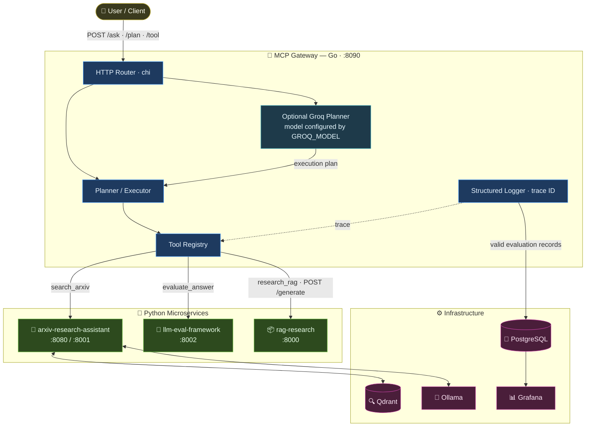

# MCP Gateway — Architecture Diagram

`retrieve_chunks` remains registered for low-level `/tool` visibility, but its
downstream `/retrieve` route is not provided by `rag-research`; it is excluded
from `/ask` and `/plan`. The evaluator does not write to PostgreSQL directly;
the gateway persists valid evaluation records asynchronously. This diagram
describes source-level wiring, not a live deployment status.
